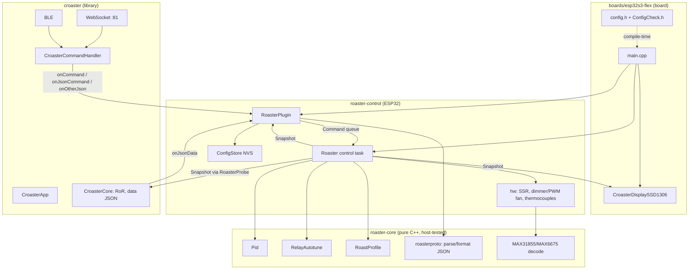

# Architecture — roaster control on Croaster

Written with the `/architect` method, applied to what's already built: ground
it (see `how.md`), set out the shape and the alternatives, screen it against
the design red flags, and list open decisions. Decision details with options
are in `design.md` (D1–D9).

## Problem

Shawn's roaster needs yaeger's level of control (firmware PID on the ESP32,
autotune, heater/fan commands, Artisan) on top of Croaster's platform (WiFi
portal, WebSocket, BLE/ICRM app, OTA, display), without breaking Croaster's
rules:
- `croaster/` stays a pin- and display-agnostic thermometer library.
- Board config lives in the board.
- `CONTEXT.md` is the source of truth.

Constraints found while grounding:
- Croaster's loop can stall for seconds (WiFi portal, OTA, BLE). A heater
  must never wait on it.
- Croaster owns the WebSocket/BLE command parser. We may only add hooks.
- Artisan matches replies by `id`, polls with one request, and can only *send*
  commands (it can't run our PID).

## Usage (caller's view)

A board wires it up in `main.cpp`. This is the whole public surface a board sees:

```cpp
Thermocouples probes(TcChip::MAX31855, SCK, MISO, CS_ET, CS_BT);
HeaterOutput heater(ROASTER_PIN_HEATER, ROASTER_HEATER_WINDOW_MS, 90, true);
FanDimmer fan(...);                                     // or FanPwm, chosen in config.h
Roaster roaster(probes, heater, fan, limits());         // control task
RoasterProbe btProbe(roaster, RoasterProbe::Channel::BT); // Croaster reads the snapshot
CroasterCore core(false, &btProbe, &etProbe);
RoasterPlugin plugin(roaster, pluginConfig());          // Croaster glue

void setup() {
    heater.begin(); fan.begin(); probes.begin();        // outputs off first
    auto s = ConfigStore::load(defaults());             // NVS
    roaster.begin(s.gains, s.pidInput, core, prio);
    plugin.attach(app, s);                              // registers commands + data hook
    app.begin();                                        // Croaster: WiFi, WS, BLE, display
    plugin.begin();                                     // ArduinoOTA
}
void loop() { app.loop(); plugin.loop(); }              // plugin.loop = watchdog
```

A client sees JSON only:

```json
{"command":{"setpoint":200}}      {"command":{"mode":"pid"}}
{"command":"autotune"}            {"command":"getData","id":7}
{"BurnerVal":60}                  {"command":"setPreferences","pidKp":5}
```

## Shape



Load-bearing decisions:
- **State has one owner.** The control task alone owns the heater, fan,
  SPI bus, mode and PID. Everyone else gets a queue for writes and a
  snapshot for reads. No locks spread through the code, and a stalled
  WebSocket can't hold the heater on (*split ownership* avoided).
- **The wire format lives in one module.** `roasterproto` turns JSON into
  `Command`s and formats data fields. The control task never sees JSON, and
  Croaster never sees `Command` (*information leakage* avoided). It is pure,
  so it is unit-tested on the PC.
- **Deep control interface.** `Roaster` exposes `begin`, `submit(Command)`,
  `snapshot()`, `loadProfile`. Mode logic, bumpless transfer, anti-windup,
  interlocks, the SSR window and autotune all sit behind those four calls.
- **Croaster changes are small additive hooks** (sensor-injection constructor,
  `onJsonData`, `onOtherJson`, MAX31855 type, BLE switch). Every existing
  board builds unchanged.
- **Board config is compile-time** (`config.h` + `static_assert`s), so a bad
  pin or a conflicting choice fails the build, not the roast.

What it deliberately does **not** do:
- Run Artisan's PC-side PID.
- Accept WiFi credentials over the wire.
- Serve its own web UI (T14).

## Synthesis decision

Three whole shapes were weighed when the skeleton was designed (see
`analysis.md`):
1. **Port yaeger onto Croaster** (chosen base: Croaster). Croaster's platform
   (portal, BLE, ICRM, OTA, multi-board) is broader. yaeger's control features
   were rebuilt as libraries, keeping its wire format for compatibility (D8).
2. **Extend yaeger with Croaster's features.** Rejected: yaeger is one
   project with globals and a loop-driven heater, so it would mean rewriting
   Croaster's platform anyway.
3. **Fork Croaster's core and put control inside it.** Rejected: every
   Croaster board would carry heater code, and upstream merges would conflict.

Taken from yaeger: command names and fields, telemetry fields, autotune fan
rules, heater 90 % cap, fan floor, PID input choice and persisted gains.
Taken from Croaster: everything about connectivity, display and boards.

## Red-flag screen (honest)

| Flag | Where | Verdict |
|:---|:---|:---|
| Two ways to do one task | Nested commands (`{"command":{"burner":..}}`) **and** yaeger flat keys (`{"BurnerVal":..}`) | Accepted on purpose for yaeger compatibility. Both end in `roasterproto` → the same `Command`, so the behaviour can't diverge. New clients should use nested. |
| Hand-synced list | `.aset` command strings vs `roasterproto` keys; `kNestedKeys` vs `parseNested` | Inside the firmware, registration loops over `kNestedKeys`/`kBasicNames`, so it's derived. The `.aset` is a separate file Artisan reads. `artisan-settings.md` documents every key. A future test could parse the `.aset` and run each command through `roasterproto` (ticket T16). |
| Pass-through | `RoasterProbe` (Croaster `Thermocouple` → snapshot) | An adapter that adds policy (NaN on fault, unit), so not a plain pass-through |
| Importable internals | Boards can include `app/roaster.h`, `hw/*` | Needed: the board constructs the drivers. Not hidden. |
| Shallow module | `RoasterPlugin` public API: `attach`/`begin`/`loop` | Deep: hides all JSON routing, NVS, watchdog and OTA |

## Tradeoffs accepted
- A dedicated control task, in exchange for one more concept (queue/snapshot)
  than Croaster's loop-only style. It is the only way a WiFi stall can't
  freeze the heater.
- Two new top-level library folders (D1), in exchange for host-testable pure
  logic and reuse by a future second roaster board.
- A force-included `config.h` (D3), in exchange for one master config file.
- A comms watchdog on traffic, not on disconnect events (D9), in exchange for
  also catching silent WiFi loss. The cost is a 10 s worst case instead of
  yaeger's instant cut on a clean disconnect.
- A Croaster core hook `onOtherJson` (D8), in exchange for exact yaeger wire
  compatibility.

## Alternatives considered
- **Control in `loop()`** (Croaster's style). Simpler, but heater safety
  would depend on the slowest thing in the loop (D7).
- **Hardware-timer ISR for control.** Can't read SPI or run floats safely in
  an ISR.
- **One combined library in `croaster/`.** Fewer folders, but every board
  (ESP8266 too) would compile heater code (D1).

## Open questions (DECISIONs for Shawn)
1. D1: top-level `roaster-core/` + `roaster-control/` folders. OK?
2. D3: force-include `config.h` into every unit. OK?
3. D6/D9: is the 10 s comms watchdog (heater off, fan to cooldown) the
   behaviour you want, or yaeger's instant cut on disconnect as well?
4. D8: keep yaeger flat-key compatibility (needs the `onOtherJson` core hook),
   or nested commands only?
5. Cooldown fan default: 100 % (ours) or 65 % (yaeger)?
6. D10: how the flex board's `platformio.ini` relates to Croaster's
   `boards/esp32s3` (standalone, `extends` his env, or a shared chip-level base
   ini). See design.md.

Resolved: D5, board id `esp32s3-flex` (Shawn, 2026-10-26).

## Next implementation step
Bench bring-up (T2): flash, confirm the OLED, both probes and `getData` in
Artisan with the new `.aset`.
