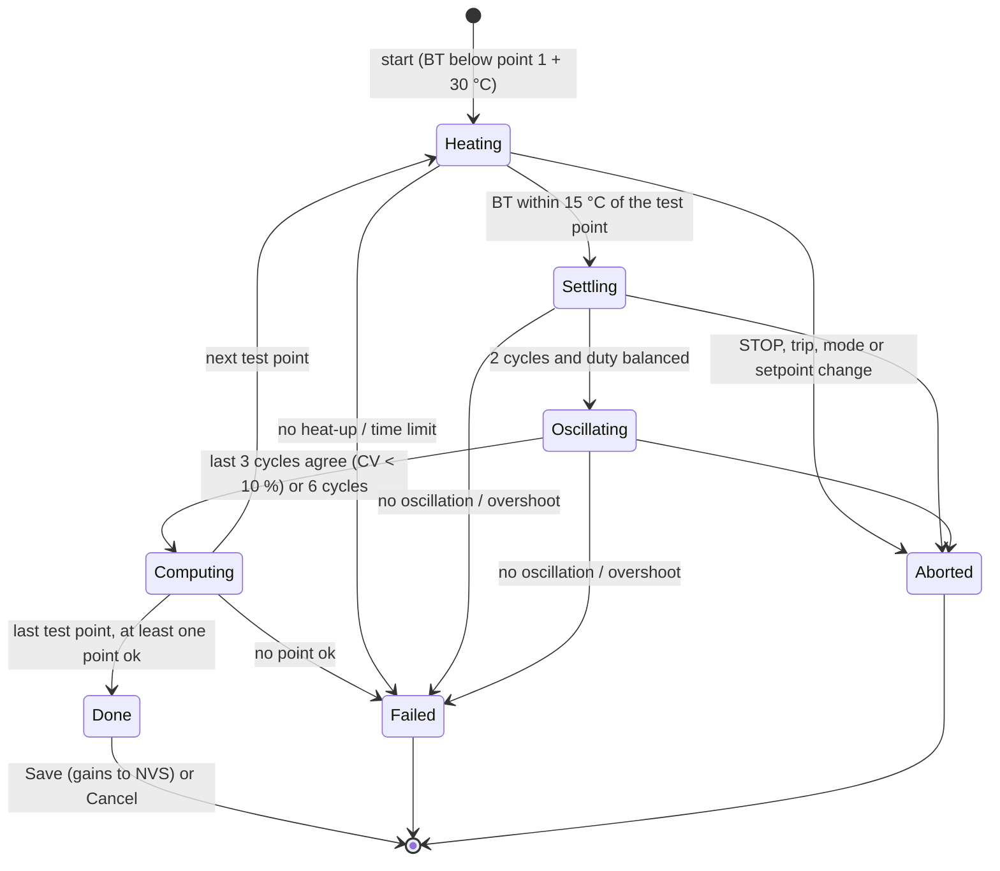

# Autotune process

What one run does. Code: `croaster-control/src/core/autotune_sequence.{h,cpp}`
(`autotune::Sequence`). Defaults are the `CPID_AUTOTUNE_*` settings in
`boards/esp32s3-pid/src/config.h`.

## Test points

`CPID_AUTOTUNE_POINT1_C` .. `POINT4_C` (°C; 0 = unused). Defaults 121.1,
148.9 and 176.7 °C (250, 300, 350 °F). At boot `autotune::makePlan`:

- drops unused and non-finite points;
- clamps each to `[100 °C, min(max setpoint, over-temperature limit − overshoot margin)]`,
  so the run can never be asked to go above the board's limits;
- sorts them low to high and merges points closer than 5 °C;
- refuses to start with no point left (`no test points`).

`ConfigCheck.h` rejects, at compile time, points under 100 °C, above
`CPID_MAX_SETPOINT_C` or not below `CPID_OVER_TEMP_C − 5 − CPID_AUTOTUNE_OVERSHOOT_C`
(240 °C with the defaults).

Why the top point is 350 °F: this build drives the heater through its own SSR
and bypasses the roaster's controls, so the roaster's thermal cutoff does not
protect the run; the firmware's limits below are the only protection. The
run holds an empty drum near each point for about 10 minutes, so the points
stay inside the roasting range rather than at its top. With the 30 °C
overshoot margin, BT during the run stays under 206.7 °C (404 °F), well below
the board's 275 °C (527 °F) over-temperature trip. Gains measured up to 350 °F
still apply in the hotter end of the roast: the plant changes slowly
with temperature and the recommended set is the most cautious of the points
(tuning-rules.md, Simulation).

## Phases

Any state can also fail on a sensor fault, over-temperature or the total time
limit; those arrows are left out of the diagram.

1. **Heating.** Heater request 100 % (the physical duty is capped by
   `CPID_HEATER_MAX_PERCENT`) until BT is within 15 °C of the test point. The
   board watches the rise: under 3 °C in 180 s fails the run with
   `no heat-up` (heater not powered, SSR or mains fault).
2. **Settling.** A relay around the test point: heater at `bias + step` while
   BT is below the point minus the hysteresis (1 °C), `bias − step` above
   the point plus the hysteresis. Step 40 %. After each full cycle the bias
   moves by `step · (t_high − t_low)/(t_high + t_low)` (Marlin's correction),
   which centres the oscillation on the test point and evens out the heating
   and cooling halves. The first point starts from a 30 % bias, low enough
   that the first heating half does not overshoot the lowest point; later points
   start from the previous point's bias scaled by the temperature rise above
   ambient. Settling ends after 2 cycles once the heating and cooling halves
   are within 20 % of each other (or 2 cycles later regardless).
3. **Oscillating.** Bias frozen; each cycle's swing (half peak to peak) and
   period are recorded. The point is measured once the last 3 cycles agree:
   the coefficient of variation of both the swing and the period is under
   10 %. At 6 cycles without that, the point is marked `unsettled`.
4. **Computing.** Means over the last 3 cycles give the ultimate gain Ku and
   period Tu, a first-order-plus-dead-time model (gain, time constant, dead
   time) and the gains for the configured rule. A swing under twice the
   hysteresis is marked `small swing` (the probe noise dominates). Then the
   next test point, or the end of the run.
5. **Done.** The recommended gains come from the points marked `ok`: the
   lowest Kp, the longest integral time and the median derivative time of
   those points. That is the most cautious set: it is stable at every point
   measured (see tuning-rules.md). With no `ok` point the run fails
   `no consistent oscillation`.

The heater returns to 0 at the end of every run: done, failed or aborted. The
board goes to Manual, with the stop path's cooldown fan
(`CPID_COOLDOWN_FAN_STOP`); a trip uses the trip fan as before.

## Safety stops

| Stop | Condition | Status text |
|---|---|---|
| Sensor fault | BT not readable (after the probe's 3-fault filter) | `failed: sensor fault` |
| Over temperature | BT above `CPID_OVER_TEMP_C − 5 °C` (270 °C, 518 °F) | `failed: over temperature` (the board's own over-temperature trip still applies) |
| Overshoot | BT more than 30 °C (54 °F) above the test point: 304, 354 and 404 °F at the default points | `failed: overshoot` |
| No heat-up | under 3 °C rise in 180 s while heating | `failed: no heat-up` |
| No oscillation | no relay switch for 900 s | `failed: no oscillation` |
| Time limit | whole run longer than `CPID_AUTOTUNE_TIME_LIMIT_MIN` (90) | `failed: time limit` |
| Too hot to start | BT above the first point + 30 °C at start (151 °C, 304 °F by default) | `failed: too hot to start` |
| User | STOP, Heater off, Stop autotune, a mode change, a setpoint change, a PID input or correction change, a heater command, a fan command that changes the fan (D23) | `aborted: <reason>` |
| Trips | comms watchdog, mains loss, over-temperature, sensor | the trip; heater off, trip fan |

The fan is raised to at least 60 % at start if it is below 30 %, so the
heater never runs with the fan nearly off.

## Progress

`Snapshot::autotuneProgress` (published every 250 ms control step) holds the
phase, point, cycle, test point, heater request, last swing and period,
elapsed and estimated remaining seconds. The telemetry `autotune` text and
the OLED header read from it:

| Phase | Telemetry `autotune` | OLED |
|---|---|---|
| Heating | `running: heating to 300 F (2/3)` | `AT2/3 heat 300F` |
| Settling | `running: settling 1/2 at 300 F (2/3)` | `AT2/3 settle 300F` |
| Oscillating | `running: cycle 3/6 at 300 F (2/3)` | `AT2/3 cyc3/6 300F` |
| Done, waiting | `results ready` | `AT results ready` |

`getAutotune` returns the full report: plan, progress, per-point results,
recommended gains and the last 24 log lines.

## How long it takes

The board estimates the run from the plan and the current BT (shown in the
confirm). On the simulated Behmor-like drum (`test_autotune.cpp`, plant
`Drum`) the three default points took 39 minutes from 25 °C, about 13
minutes per point: a few minutes of heat-up, then 5 to 7 cycles of 130 to
140 s (the lowest point cycles slowest). Expect
45 to 65 minutes on a real Behmor 2000AB; the 90-minute limit is the backstop.
