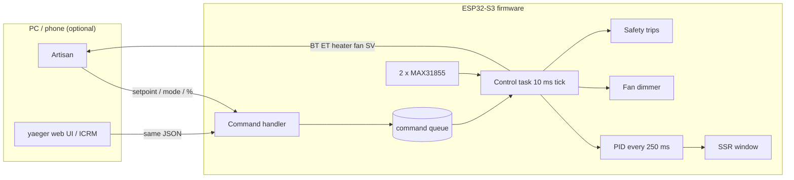

# Control parity with yaeger

Goal from Shawn: the ESP32 controls the heater 100 % itself, with **the same
level of control yaeger's firmware has**. This compares yaeger's control
surface item by item against this firmware. yaeger source: Shawn's yaeger tree,
mainly `CommandLoop.cpp`, the PID/heater/fan code and its web UI.

Status:
- **match**: same behaviour.
- **closed**: was a gap, fixed in this change.
- **better**: ours does more.
- **different**: on purpose, with the reason.

## What "control" means here

The PID loop is entirely on the ESP32, as in yaeger. Clients only send
targets and commands. If every client goes away, the ESP32 keeps controlling
until the comms watchdog stops the heater.

## Commands (what a client can tell the roaster)

| yaeger | Ours | Status |
|:---|:---|:---|
| `{"BurnerVal":v}`: heater %, switches to Manual | `{"command":{"burner":v}}` or `{"command":"setBurner","value":v}`; the flat key is not accepted | **dropped** (D8, 2026-10-26) |
| `{"FanVal":v}` | `{"command":{"fan":v}}` or `setFan`; flat key not accepted | **dropped** (D8) |
| `{"Setpoint":T}`, clamped 0..250 | `{"command":{"setpoint":T}}`, clamped to `FLEX_MAX_SETPOINT_C` 250; flat key not accepted | **dropped** (D8) / clamp matches |
| `{"Mode":"Manual"\|"PID"}` (prefix match) | `{"command":{"mode":"manual"\|"pid"}}`; flat key not accepted | **dropped** (D8) |
| `{"Target":"ET"\|"BT"\|"MAX"}`: PID input, saved | `{"command":{"pidInput":..}}`, saved to NVS; flat key not accepted | **dropped** (D8) |
| `{"command":"setBurner","value":v}` / `setFan` | Same | **closed** |
| `{"command":"autotune"}` | Same (relay autotune, Tyreus–Luyben) | match / **better** (see below) |
| `{"command":"setPreferences","pidKp","pidKi","pidKd","cooldownFanSpeed"}`: applied and saved | Same keys, applied and saved to NVS. Also `{"command":{"pid":{..}}}`, `{"command":{"cooldownFan":v}}` | **closed** |
| `{"command":"getPreferences"}` → `{"id","data":{"type":"preferences",...}}` | Same reply format | **closed** |
| `setPreferences` `wifiSsid`/`wifiPass` | Not accepted. WiFi is set in Croaster's WiFiManager portal. | **different**: one place for credentials, and nothing on the network can rewrite them |
| — | `stop` (heater off, cooldown fan), `clearTrip`, `startProfile`, `profile` upload, `getControl` | **better** |

## Control behaviour

| yaeger | Ours | Status |
|:---|:---|:---|
| PID on the ESP32 | PID on the ESP32, core 1, own FreeRTOS task (10 ms tick, PID every 250 ms), not blocked by WiFi or the display | match / **better** |
| Heater ceiling 90 % | `FLEX_HEATER_MAX_PERCENT 90`, applied after PID and manual | match |
| Fan floor: heat > 0 and fan ≤ 10 → fan 30 | Fan forced to ≥ `FLEX_MIN_FAN_WITH_HEAT` (30) whenever heating | match (slightly stricter: 11–29 % is also raised) |
| Autotune: fan to 60 if below 30 | Same | match |
| Autotune done: fan 30, setpoint 0, gains saved | Same, gains saved to NVS | match |
| Anti-windup: integral clamp at 0.8 | Conditional integration (integral frozen while the output is saturated) | **better**: no overshoot from a stored integral |
| Manual → PID switch | Bumpless: integral preset to the current heater % | match / **better** |
| Setpoint 0 → >0 in PID resets the PID | Same (`Controller::apply` SetSetpoint) | **closed** |
| Heater drive: 50 Hz PWM on an SSR pin | Time-proportional SSR window (zero-cross SSR switches whole half-cycles, so fast PWM gets rounded off) | **better** for a zero-cross SSR |
| Fan drive: PWM / dimmer | AC dimmer (zero-cross + phase angle) or PWM, chosen in `config.h` | match |
| Profile follower: in the README only, not in Shawn's yaeger code | Firmware profiles: steps of duration/setpoint/interpolation/fan, run on the ESP32 | **better** |
| Cooldown fan default 65 % | 65 % after `stop` (`FLEX_COOLDOWN_FAN_STOP`), 100 % when any trip starts (`FLEX_COOLDOWN_FAN_TRIP`); both changeable via `cooldownFan`, the stop value also via `setPreferences`, saved | **match** after stop; trips follow yaeger's disconnect (D19) |

## Safety

| yaeger | Ours | Status |
|:---|:---|:---|
| Client disconnects while Manual and heating → heater 0, fan 100 | Comms watchdog: no client message for the timeout (10 s default, configurable, can be turned off) while heating (Manual, PID or Autotune) → heater 0, fan to the trip speed (100 %), `trip:"comms"`. Profiles keep running on their own. | **closed** (was 30 s and didn't set the fan). See D9. |
| — | Over-temperature (any probe > 275 °C) → heater off, fan 100 | **better** |
| — | Probe fault (open, short) for 2 s in PID, Profile or Autotune → heater off (Manual keeps going, as yaeger did) | **better** |
| — | AC dimmer sees no mains → heater off | **better** |
| — | OTA starting → heater off | **better** |

## Telemetry (what the roaster reports)

| yaeger status field | Ours | Status |
|:---|:---|:---|
| `ET`, `BT` | `ET`, `BT` (+ Croaster's RoR `DET`, `DBT`) | match / better |
| `Amb` | `Amb` = MAX31855 cold-junction temp of the BT chip (null on MAX6675 or before the first sample) | **closed** |
| `BurnerVal`, `FanVal` | same | match |
| `Setpoint` | `SV` | **different**: Artisan-style name. The `.aset` reads `SV`. |
| `Mode` | `Manual` / `PID` / `Tuning` / `Profile` | match (+Profile) |
| `Target` | same | **closed** |
| `pidKp/pidKi/pidKd` | same | **closed** |
| `wifiStrength` | same (RSSI) | **closed** |
| 100 ms broadcast with no `id` | Croaster broadcast (id 0) **and** a correct reply to Artisan's `getArtisanData` with its `id` | **better**: yaeger never answers `getData` with the id, so current Artisan can't read it |

## Gaps found and closed in this change
1. yaeger's flat-key messages (`BurnerVal`, `FanVal`, `Setpoint`, `Mode`,
   `Target`) are not accepted. Shawn chose to drop them on 2026-10-26 (D8):
   nothing we ship sends them, and accepting them needed a core change.
   yaeger's web UI and old yaeger `.aset` files don't work with flex.
2. `setBurner`/`setFan`/`setPreferences`/`getPreferences` were missing. Now
   implemented with yaeger's reply format.
3. Telemetry lacked `Amb`, `Target`, `pidKp/Ki/Kd` and `wifiStrength`. Added.
4. Disconnect while heating: 30 s and heater only. Now 10 s, and the fan goes
   to the trip speed (D9, D19).
5. Setpoint 0 → >0 in PID didn't reset the PID. Now it does.
6. The `.aset` turned on Artisan's software PID and swapped BT/ET. Fixed (see
   `artisan-settings.md`).

## Still open
- Bench-test all of the above on hardware (T6–T8, T15).
