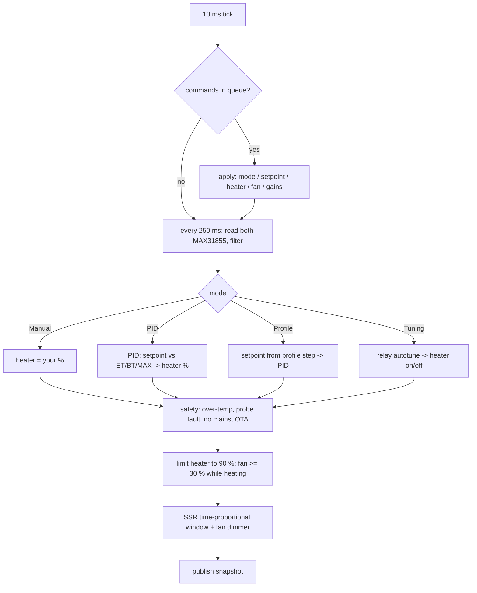
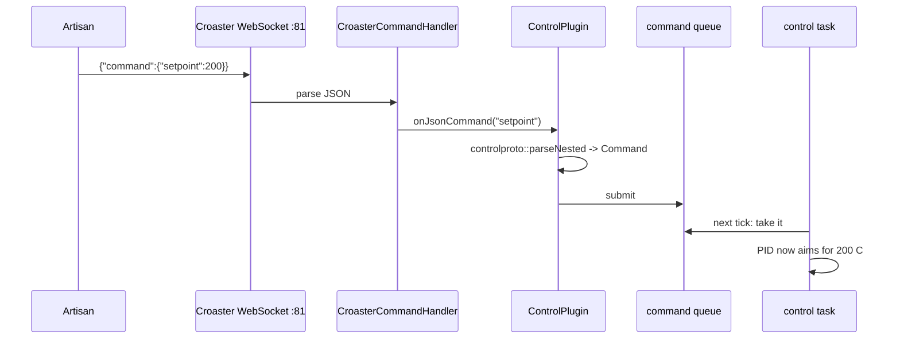

# How the Croaster PID control firmware works

Plain-language tour of `rework/roaster`, written with the `/how` method:
overview, key ideas, the flow step by step, where things live, gotchas.

## Overview

The firmware runs on an ESP32-S3 inside the roaster. It reads two
thermocouples (BT = bean temp, ET = environment/air temp), drives the heater
through an SSR and the fan through an AC dimmer, and shows status on the 0.96"
SSD1306 OLED. It runs the PID itself: once you set a target temperature, the
ESP32 holds it without any PC attached.

It is built on **Croaster**, an existing open-source thermometer firmware.
Croaster already does WiFi setup, the WebSocket server Artisan connects to,
Bluetooth for the ICRM phone app, OTA updates and the display framework. We
added the control parts (heater, fan, PID, autotune, profiles, safety) as
separate libraries that plug into Croaster through hooks. Croaster stays a
thermometer library, and the control logic sits next to it.

## Key ideas

- **Control task.** A dedicated FreeRTOS task (think: a separate thread with
  high priority) that wakes every 10 ms. It reads the probes, runs the PID
  every 250 ms, switches the SSR and sets the fan. Nothing else touches the
  heater, so WiFi hiccups or a busy display can't leave it stuck on.
- **Command queue in, snapshot out.** The rest of the firmware never calls the
  heater directly. It drops a command ("fan 60 %") into a queue. The control
  task applies it on its next tick and publishes a read-only **snapshot**
  (temps, heater %, fan %, mode, trip) that everyone else reads.
- **Modes.** `Manual` (you set heater %), `PID` (you set a temperature),
  `Profile` (the firmware walks a list of time/temperature steps) and
  `Tuning` (relay autotune finds PID gains).
- **Trips.** Safety stops: over-temperature, probe fault, no zero-cross from
  the dimmer (2 s without a break while heating, `CPID_MAINS_GRACE_MS`), OTA in
  progress, and lost comms. A trip turns the heater off and
  stays latched until `clearTrip`.
- **ControlPlugin.** The glue. It registers our JSON commands with Croaster,
  adds our fields to the data Croaster sends, runs the comms watchdog and
  saves settings to flash (NVS).

## How it works

### Boot
`boards/esp32s3-pid/src/main.cpp` `setup()`:
1. Heater and fan outputs start **off** before anything else.
2. Saved settings (PID gains, PID input, cooldown fan) load from NVS.
3. The control task starts on core 1.
4. `UnitStore::attach()` applies the saved temperature unit (or
   `CMON_TEMP_UNIT` when none is saved) and saves later `tempUnit` changes.
5. `plugin.attach()` registers the commands, then `app.begin()` brings up
   WiFi (captive portal on first boot), WebSocket :81, BLE and the display.
6. Once WiFi is connected and the portal is closed, `webUi.loop()` starts
   the browser page's HTTP server (see "The browser page").

### One control tick

The SSR is a zero-cross type, so it can only switch at whole mains
half-cycles. Instead of fast PWM, heater % becomes "on for X ms out of each
window", which a zero-cross SSR follows accurately.

### A command from Artisan

yaeger's named commands (`{"command":"setBurner","value":60}`, `setFan`,
`setPreferences`, `getPreferences`) go through the same path: `onCommand`
hands them to `parseLegacy`. yaeger's flat keys (`{"BurnerVal":60}`) are
ignored, because Croaster's handler only routes messages with a `"command"`
member (D8).

### Data going out
Every second Artisan sends `{"command":"getArtisanData","id":N}`. Croaster
answers with its data (`BT`, `ET`, RoR) plus our fields from the snapshot: `BurnerVal`, `FanVal`,
`SV`, `Mode`, `trip`, `autotune`, `Target`, `pidKp/Ki/Kd`, `Amb`, `wifiStrength`. Croaster
also broadcasts the same data to the ICRM app.

### Two probes, end to end
ET and BT are two MAX31855 boards on one SPI bus: shared SCK (GPIO 12) and
MISO (GPIO 13), one chip-select each (`CMON_PIN_TC_CS_ET` 10,
`CMON_PIN_TC_CS_BT` 11, in `config.h`; `ConfigCheck.h` rejects a reused pin).

| Step | Where | What happens |
|:---|:---|:---|
| Read | `hw/thermocouples.cpp` | Every 250 ms the control task pulls CS_ET low and reads 32 bits, then the same for CS_BT (FSPI, 1 MHz). |
| Decode | `core/max31855.h` | One frame gives the temperature, the cold junction and the fault bits (open, short to GND, short to VCC; all-0 or all-1 means no chip). |
| Filter | `core/probe_channel.h` | One `ProbeChannel` per probe: 4-sample average; one or two bad reads hold the last value; the third in a row gives NaN; a reconnected probe starts fresh. The two channels never affect each other. |
| Control | `app/controller.cpp` | The snapshot carries `et`, `bt`, `etFault`, `btFault` and `ambient` (cold junction of the BT chip, or the ET chip when no BT chip answers). NaN on the PID input outside Manual, or on both probes while Manual heats, trips `sensor` after 2 s (`sensorFault()`). |
| Correct | `core/probe_correction.h` | PID, autotune and the over-temperature check add Croaster's `correctionBt`/`correctionEt` (as °C, from `ControlPlugin`), so they work on the displayed scale. The snapshot stays uncorrected (D22). |
| Croaster | `app/RoasterProbe.h` | Two adapters (`Channel::BT`, `Channel::ET`) hand the snapshot values to `CroasterCore`, which computes RoR. |
| Telemetry | `CroasterCore::getJsonData` | `BT`/`ET` and `DBT`/`DET` (RoR); a faulted probe's keys are left out, which Artisan shows as a gap. |
| Screen | `CroasterDisplaySSD1306` | BT and ET with RoR; a faulted probe shows `N/A`. |

Host tests cover the decode and filter steps (`test_max31855_*`,
`test_probe_channels_independent_faults`) and the correction step
(`test_correction_*`, `test_overtemp_uses_raw_and_corrected`,
`test_snapshot_stays_uncorrected`). Wiring and the real chips are
checked on the bench (tickets T2, T3).

### The browser page
`http://<board ip>/` serves a page from the firmware (`croaster-webui/`).
The HTTP server only hands out the page files; everything else goes through
Croaster's WebSocket on port 81, exactly like Artisan:

1. The browser loads `/` (HTML, CSS, scripts: about 47 KB gzipped, built
   into the firmware) and `/info.json` (board id, WebSocket port, whether to
   show Controls).
2. A Web Worker opens `ws://<ip>:81/` and sends `getArtisanData` every
   second, `getControl` every 5 s and `getDeviceInfo` every 30 s.
3. The page opens on Monitoring (or the view named in the URL hash).
   Opening a view sends nothing. The tiles always show the latest reply.
   Replies become chart samples only while a roast is recording: Start
   (top bar) begins one and sends nothing to the board, STOP or End roast
   ends it. Charge sets the roast clock to 0:00; the preheat before it stays
   on the chart at negative times. RoR is the board's `DBT`, or a 30 s
   least-squares slope worked out in the browser.
4. Event buttons (Charge only after Start, then Dry end ... Drop in order),
   the roast clock and the samples stay in
   the browser's storage. CSV export writes them out.
   STOP asks first, sends `{"command":"stop"}` (heater 0, Manual, cooldown
   fan; no reply), ends the recording and then watches the readings for
   Manual with heater 0. Controls > Safety has Heater off for the same
   command when nothing is recording.
5. Controls send the same JSON commands as in the board README and show the
   reply or error next to the log.
6. Controls > Device library (Croaster PID) lists the profiles kept on the
   board with `libraryList` when the link opens or Controls is shown; no
   reply in 4 s shows it as unavailable. Edit opens a profile in the profile
   and recipe editors; Save editors to device asks before replacing a
   profile of the same name.
7. Controls > Recipe edits recipe steps (default: heater % and fan % at a
   time since Charge). Load to device sends `recipeLoad`, Run recipe sends
   `recipeStart`. On Live, the recipe panel shows the next step, the fired
   list, guided prompts and the behind-schedule warning. The page fetches
   `getRecipe` only when the data's `recipe.seq` changes.

### Recipes on the board
`app/RecipePlugin` owns a `recipe::Runner` and a `recipe::RoastClock`
(`core/recipe.h`, host tested). Every 250 ms on the loop task it builds the
inputs (BT, ET, RoR in °C from the corrected readings, the setpoint, the
roast clock) and ticks the runner. The runner returns controller commands
(`SetMode`, `SetHeater`, `SetFan`, `SetSetpoint`) and a stop flag; the plugin
submits them through `Controller::submit`, so every interlock applies. A
setpoint ramp is a stream of `SetSetpoint` every 500 ms. `ControlPlugin`
calls the plugin's stop hook on `stop`, Stop and emergency off, which aborts
the recipe; a trip is seen in the inputs and aborts it on the next tick;
OTA aborts it in `loop()`. Event triggers and time since CHARGE come from
`roastEvent`, which the page sends on each event mark and undo.

The profile library (`core/profile_library.h`, `app/library_storage`,
`app/LibraryPlugin`) keeps one JSON file per profile on LittleFS. Load reads
the file, validates both parts on the heap (not on the loop stack, see
Gotchas), loads `steps` into the controller and `recipe` into the runner.

Colours and style: `theme.js` runs in `<head>`, reads `croaster.theme`
from the browser's storage and sets CSS custom properties (`--bg`, `--bt`,
`--line-width`, ...) on `<html>` before the page paints. Every rule in
`app.css` and every chart line uses those properties, so the Appearance panel
only has to change them; nothing is redrawn. The panel saves the whole scheme
as JSON under the same key.

The worker exists because browsers slow timers in a hidden tab, and a slow
poll would trip the comms watchdog mid-roast. Closing the tab, a sleeping
laptop or iOS Safari in the background still stops the polls, and the
watchdog trips as it should.

Connection handling (`link.worker.js`, `link.js`):
- The URL is `ws://<host>:81/` when the page came over http. Over https the
  browser refuses `ws://` (mixed content), so the page uses
  `wss://<host>/ws` and the reverse proxy in front of the board has to
  forward that path to port 81 with the WebSocket upgrade headers (the
  board's WebSocket server accepts any path). `?ws=` still overrides both.
- A socket with no message for 10 s is dropped and a new one opened at once,
  without waiting for the close handshake; a handshake not done in 8 s is
  abandoned. Retries back off 1, 2, 4, 8, 10 s.
- While the page is hidden and nothing needs the polls (no recording, heater
  0, Manual; any monitor), the socket is closed and reopened when the page
  is shown, and on `pagehide`. A phone otherwise suspends the page with the
  socket still open, and the board then waits on writes to it.
- Monitoring > Connection shows the URL, state, last message, round trip,
  connections opened and attempted, the last close, the board's uptime
  (`timer`) and the restarts seen from it.

### Watchdog
Croaster's command handler records when it last accepted a message
(`lastCommandMillis()`, WebSocket or BLE). If the heater is on (Manual, PID or
Autotune) and that is older than the timeout (10 s by default), the plugin
trips `comms`: heater off; the controller sets the fan to the trip speed. Profiles are exempt
because they are meant to run on their own. The timeout and an off switch are
settings; see the board README, "Comms watchdog".

## Where things live

| Path | What |
|:---|:---|
| `boards/esp32s3-pid/src/config.h` | **The one file to edit**: pins, parts, limits, PID defaults |
| `boards/esp32s3-pid/src/ConfigCheck.h` | Compile-time checks on config.h (bad pins, conflicts) |
| `croaster-control/src/hw/esp32s3_opi_pins.h` | ESP32-S3 octal-PSRAM pin rules both boards' `ConfigCheck.h` use; board wiring (UART0, RGB LED) stays in each `ConfigCheck.h` |
| `boards/esp32s3-pid/src/main.cpp` | Wires everything together |
| `boards/common` `CroasterDisplaySSD1306` | The OLED screen: Croaster's shared SSD1306 display; `main.cpp` sets its header text to heater/fan/mode |
| `boards/esp32s3-pid/artisan/croaster-pid.aset` | Artisan settings (see `artisan-settings.md`) |
| `boards/esp32s3-pid/test/` | Host unit tests (`pio test -e native`) |
| `boards/esp32s3-monitor/` | Croaster monitor: the same probes and screen with no heater, fan or control task (`app/MonitorProbes`) |
| `croaster-control/src/core/` | Pure logic: PID, autotune, profiles, protocol, MAX31855 decoding, probe fault filter, safety rules. The only part the host tests compile |
| `croaster-control/src/app/controller.*` | The control task |
| `croaster-control/src/app/ControlPlugin.*` | Commands, data fields, watchdog |
| `croaster-control/src/app/config_store.*` | NVS settings (gains, PID input, cooldown fan, watchdog) |
| `croaster-control/src/hw/` | SSR, dimmer, PWM fan, thermocouple bus |
| `croaster-control/src/app/unit_store.*`, `core/temp_unit.h` | Saved temperature unit (NVS `croaster`/`unit`) |
| `croaster-control/src/core/recipe.*` | Recipe format, parser, roast clock and step runner (pure, host tested) |
| `croaster-control/src/app/RecipePlugin.*` | Recipe commands, data field, 4 Hz tick on the loop task |
| `croaster-control/src/core/profile_library.*`, `app/library_storage.*`, `app/LibraryPlugin.*` | Profile library: format and limits (pure), LittleFS backend, commands |
| `croaster-webui/` | The browser page: `web/` sources, `embed_assets.py` (gzips them into the firmware), `WebUiServer` (HTTP), tests |
| `croaster/src/` | Croaster library (WiFi, WebSocket, BLE, OTA, RoR) |

## Gotchas
- **Stack depth in command handlers.** Croaster calls command handlers from
  inside the WebSockets library's nested read callbacks, so a handler starts
  several KB deep in the loop task stack (16 KB on the S3 boards). Write a
  reply straight into its JsonDocument; don't copy one document into another
  (`doc["response"] = other` recurses) and don't keep large arrays on the
  stack. `getControl` `loopStackFree` shows the margin.
- **A recipe still needs a connected client.** The comms watchdog exempts
  only Profile mode; a recipe running in Manual or PID trips it like any
  other heat if no client polls for the timeout.
- **Units.** Temperatures in commands use Croaster's unit setting (°F by
  default; a `tempUnit` change is saved and survives a reboot). Keep Artisan
  in the same unit as the board.
- **The browser page has no password.** Anyone on the network can open it
  and, on Croaster PID, run the heater, the same as with the WebSocket on
  port 81. An open page also keeps the comms watchdog fed.
- **Two PIDs exist in the world.** Artisan has its own software PID ("Control"
  button). It is turned off in our `.aset`. Ours runs on the ESP32. See
  `control-parity.md`.
- **PID and profiles need tuned gains first** (`CPID_REQUIRE_AUTOTUNE 1`):
  until an autotune completes or gains are sent with the `pid` command, they
  are refused with `autotune required` (D24).
- **Autotune needs a setpoint ≥ 100 °C (212 °F)** and a working probe. The
  `autotune` field in each data sample and in `getControl` says why it
  refused, failed or stopped; the OLED header shows it for 10 s.
- **Probe faults in Manual don't trip.** As in yaeger, Manual keeps your
  heater %. PID, Profile and Autotune trip after 2 s of bad readings.
- **One stalled reader freezes the board's loop.** Croaster's WebSocket
  server (links2004 WebSockets 2.7.3, 5 clients) writes to each client with
  blocking calls: a client that stops reading (a suspended phone tab, a
  dead proxy link) holds `loop()` for up to about 10 s per message once its
  send buffer is full, and there is no ping to drop it. Every other client
  then goes silent and reconnects. The page closes its socket when hidden
  and idle to limit this; the server-side fix is a heartbeat in
  `CroasterWebSocketManager` (not done: upstream code).
- **WiFi modem sleep is off** (`CMON_WIFI_SLEEP 0`). With it on, the radio
  wakes only for the router's beacons and every reply waits 100–300 ms.
  If a board resets at boot after a change here, set it to 1.
- **USB serial can stall the board too.** On the S3 boards `Serial` is the
  native USB port. A PC program that opened the port and stopped reading
  used to block each log line for about 2 s, and Croaster logs every
  WebSocket command. `setup()` now sets `Serial.setTxTimeoutMs(0)` so lines
  are dropped instead. Croaster reads nothing from Serial. The port's
  DTR/RTS lines can still reset the chip (reset reason `0x15
  USB_UART_CHIP_RESET` in the boot log); the page logs a restart when the
  board's uptime goes backwards.
- **Roast sessions are per browser.** A roast started on the laptop is not
  seen on the phone: the session is in each browser's storage. Sharing it
  needs the board to hold the session (T53 notes).
- **`.local` names** don't always resolve on Windows. Use the IP on the OLED.
- **Line endings.** `.gitattributes` checks text files out with LF on every
  platform, whatever `core.autocrlf` says, and keeps any `.bat`, `.cmd` or
  `.ps1` as CRLF. `embed_assets.py` also folds CRLF to LF before hashing, so
  a CRLF copy of `web/` still matches the committed `webui_assets.h`. A clone
  made before `.gitattributes` existed may still hold CRLF files: commit or
  stash, then refresh it (see CHANGELOG, "Line endings").
- **Nothing is hardware-tested yet.** It builds and the host tests pass.
  Bench tickets T2–T9 are next.
