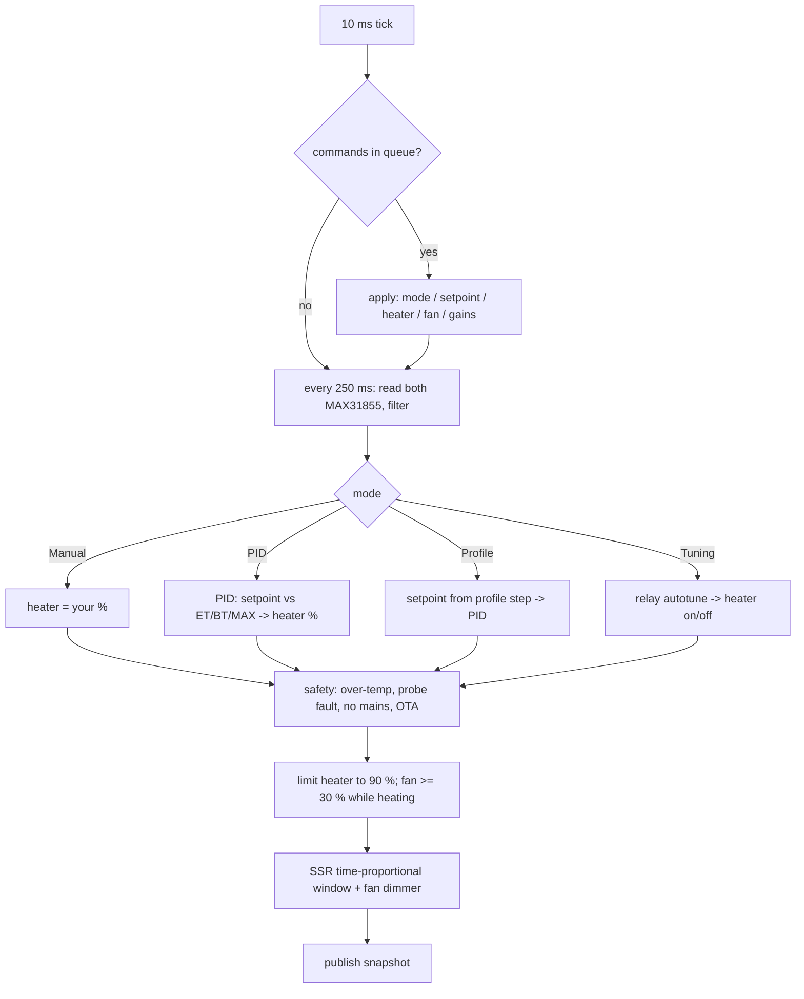
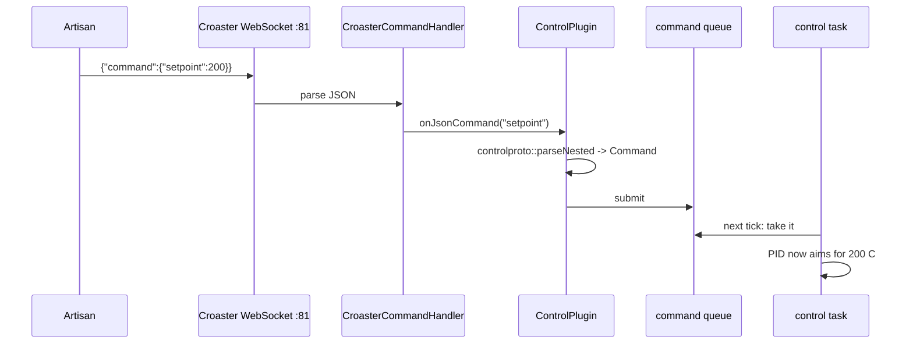

# How the flex control firmware works

Plain-language tour of `rework/roaster`, written with the `/how` method:
overview, key ideas, the flow step by step, where things live, gotchas.

## Overview

The firmware runs on an ESP32-S3 inside the roaster. It reads two
thermocouples (BT = bean temp, ET = environment/air temp), drives the heater
through an SSR and the fan through an AC dimmer, and shows status on the 0.96"
SSD1306 OLED. It runs the PID itself: once you set a target temperature, the
ESP32 holds it without any PC attached.

It is built on **Croaster**, an existing open-source thermometer firmware.
Croaster already does WiFi setup, the WebSocket server Artisan connects to,
Bluetooth for the ICRM phone app, OTA updates and the display framework. We
added the control parts (heater, fan, PID, autotune, profiles, safety) as
separate libraries that plug into Croaster through hooks. Croaster stays a
thermometer library, and the control logic sits next to it.

## Key ideas

- **Control task.** A dedicated FreeRTOS task (think: a separate thread with
  high priority) that wakes every 10 ms. It reads the probes, runs the PID
  every 250 ms, switches the SSR and sets the fan. Nothing else touches the
  heater, so WiFi hiccups or a busy display can't leave it stuck on.
- **Command queue in, snapshot out.** The rest of the firmware never calls the
  heater directly. It drops a command ("fan 60 %") into a queue. The control
  task applies it on its next tick and publishes a read-only **snapshot**
  (temps, heater %, fan %, mode, trip) that everyone else reads.
- **Modes.** `Manual` (you set heater %), `PID` (you set a temperature),
  `Profile` (the firmware walks a list of time/temperature steps) and
  `Tuning` (relay autotune finds PID gains).
- **Trips.** Safety stops: over-temperature, probe fault, no mains for the
  dimmer, OTA in progress, and lost comms. A trip turns the heater off and
  stays latched until `clearTrip`.
- **ControlPlugin.** The glue. It registers our JSON commands with Croaster,
  adds our fields to the data Croaster sends, runs the comms watchdog and
  saves settings to flash (NVS).

## How it works

### Boot
`boards/esp32s3-flex/src/main.cpp` `setup()`:
1. Heater and fan outputs start **off** before anything else.
2. Saved settings (PID gains, PID input, cooldown fan) load from NVS.
3. The control task starts on core 1.
4. `plugin.attach()` registers the commands, then `app.begin()` brings up
   WiFi (captive portal on first boot), WebSocket :81, BLE and the display.

### One control tick

The SSR is a zero-cross type, so it can only switch at whole mains
half-cycles. Instead of fast PWM, heater % becomes "on for X ms out of each
window", which a zero-cross SSR follows accurately.

### A command from Artisan

yaeger-style messages (`{"BurnerVal":60}`, `{"command":"setBurner","value":60}`)
go through the same path. `onOtherJson` and `onCommand` hand them to
`parseLegacy`, so yaeger's web UI or settings would also work.

### Data going out
Every second Artisan sends `{"command":"getData","id":N}`. The plugin marks
"client alive" for the watchdog and answers with Croaster's data
(`BT`, `ET`, RoR) plus our fields from the snapshot: `BurnerVal`, `FanVal`,
`SV`, `Mode`, `trip`, `Target`, `pidKp/Ki/Kd`, `Amb`, `wifiStrength`. Croaster
also broadcasts the same data to the ICRM app.

### Watchdog
If the heater is on (Manual, PID or Autotune) and no client has sent anything
for 10 s, the plugin trips `comms`: heater off, fan to the cooldown speed.
Profiles are exempt because they are meant to run on their own.

## Where things live

| Path | What |
|:---|:---|
| `boards/esp32s3-flex/src/config.h` | **The one file to edit**: pins, parts, limits, PID defaults |
| `boards/esp32s3-flex/src/ConfigCheck.h` | Compile-time checks on config.h (bad pins, conflicts) |
| `boards/esp32s3-flex/src/main.cpp` | Wires everything together |
| `boards/common` `CroasterDisplaySSD1306` | The OLED screen: Croaster's shared SSD1306 display; `main.cpp` sets its header text to heater/fan/mode |
| `boards/esp32s3-flex/artisan/croaster-flex.aset` | Artisan settings (see `artisan-settings.md`) |
| `boards/esp32s3-flex/test/` | Host unit tests (`pio test -e native`) |
| `control-core/src/core/` | Pure logic: PID, autotune, profiles, protocol, MAX31855 decoding |
| `control-esp32/src/app/controller.*` | The control task |
| `control-esp32/src/hw/` | SSR, dimmer, PWM fan, thermocouple bus |
| `control-esp32/src/ControlPlugin.*` | Commands, data fields, watchdog, ArduinoOTA |
| `croaster/src/` | Croaster library (WiFi, WebSocket, BLE, OTA, RoR) |

## Gotchas
- **Units.** Temperatures in commands use Croaster's unit setting. Keep
  Croaster and Artisan both in °C.
- **Two PIDs exist in the world.** Artisan has its own software PID ("Control"
  button). It is turned off in our `.aset`. Ours runs on the ESP32. See
  `control-parity.md`.
- **Autotune needs a setpoint ≥ 100 °C** and a working probe. It reports progress in
  `getControl` → `autotune`.
- **Probe faults in Manual don't trip.** As in yaeger, Manual keeps your
  heater %. PID, Profile and Autotune trip after 2 s of bad readings.
- **`.local` names** don't always resolve on Windows. Use the IP on the OLED.
- **Nothing is hardware-tested yet.** It builds and the host tests pass.
  Bench tickets T2–T9 are next.
